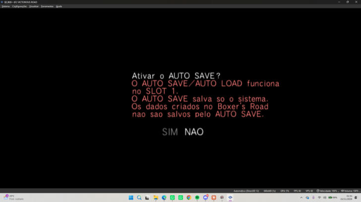
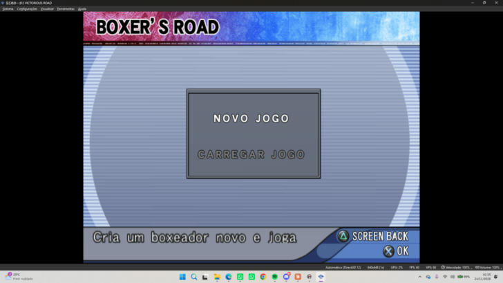
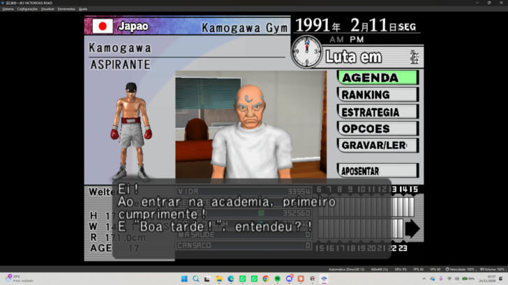

# Hajime no Ippo 2: Victorious Road — Tradução PT-BR (PS2)

Tradução de fã do jogo japonês **Hajime no Ippo 2: Victorious Road** (SLPS-25287) para português do Brasil.

Este repositório tem **só a tradução e as ferramentas**. Ele não tem a ISO nem arquivos do jogo: você precisa da sua própria cópia.

## O que está traduzido
- 10.417 falas do modo Boxer's Road (treinos, lutas, fofocas, aniversários, sparring, pesagem etc.) em `traducao/falas_pt.json`
- Uns 220 textos de menu e botões (SIM/NAO, NOVO JOGO, VIDA, FOLEGO...) em `traducao/menus_pt.json`
- Linhas com no máximo 37 caracteres e 4 linhas por página, que é o limite da caixa de texto do jogo
- Sem acentos, porque a fonte do jogo não tem

## Ainda falta
- Textos que são imagens: menu principal, "Boxer Registration", ícones SCREEN BACK/CANCEL/OK e a linha do tempo do "Start Time Select"
- 5 falas misturadas com código do jogo
- "SAVE" e alguns nomes de países que não cabem no espaço

## Ferramentas (`ferramentas/`)
- `gvx2.py`: lê e regrava texto nos arquivos `.gvx` (versão 1 e 2)
- `rewrap.py`: quebra as linhas no limite da caixa de texto
- `check.py`: confere os códigos de controle (`_w`, `_tc`, `_mf[...]`), caracteres e tamanho das linhas
- `build.py`: aplica as falas traduzidas nos `.gvx` extraídos da ISO
- `elfpatch.py`: troca os textos de menu no executável `SLPS_252.87`
- `PROMPT.md`: glossário e regras de estilo usadas na tradução
- `aplicar_traducao.ps1` / `APLICAR.bat`: grava os arquivos traduzidos (pasta `arquivos/`) numa **cópia** da ISO japonesa e gera `Hajime no Ippo 2 - Victorious Road (PT-BR).iso`. A ISO original não é alterada.

## Prints

Testado no PCSX2 2.x.
